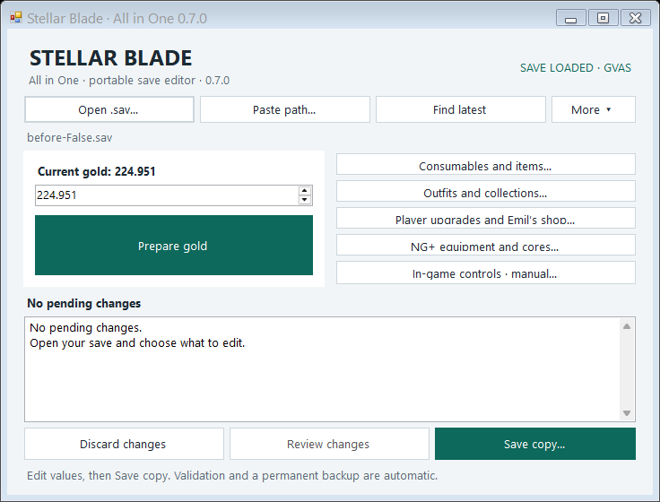
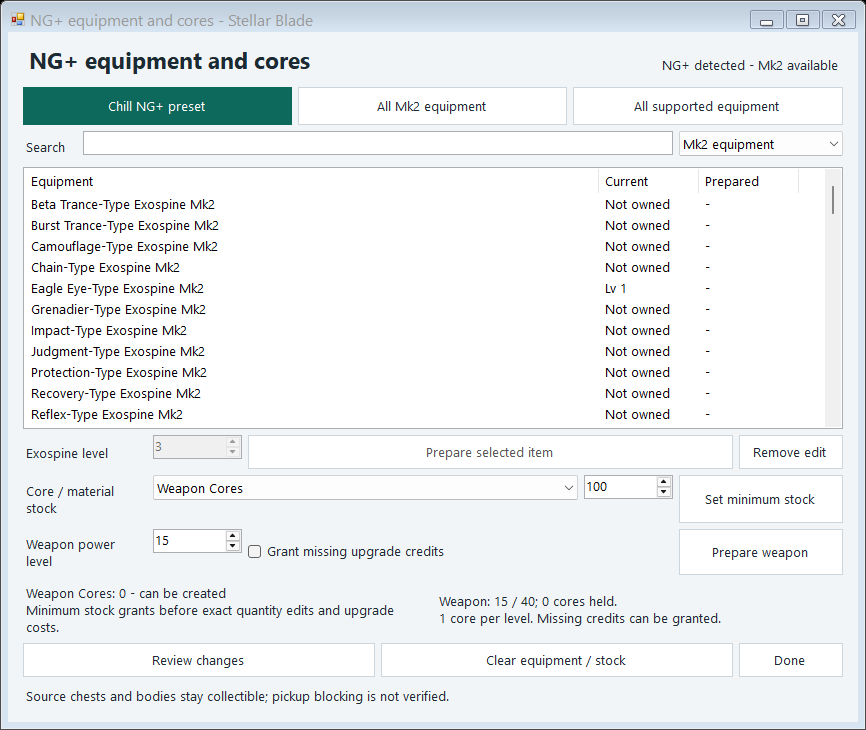
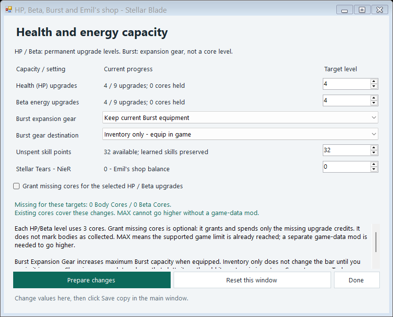
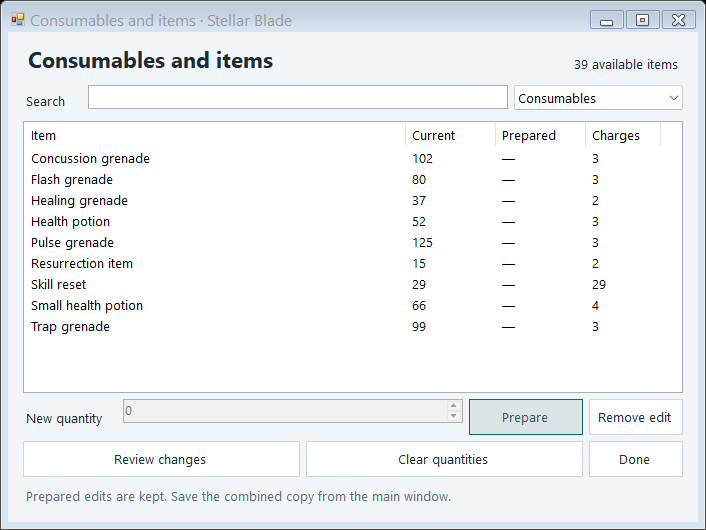
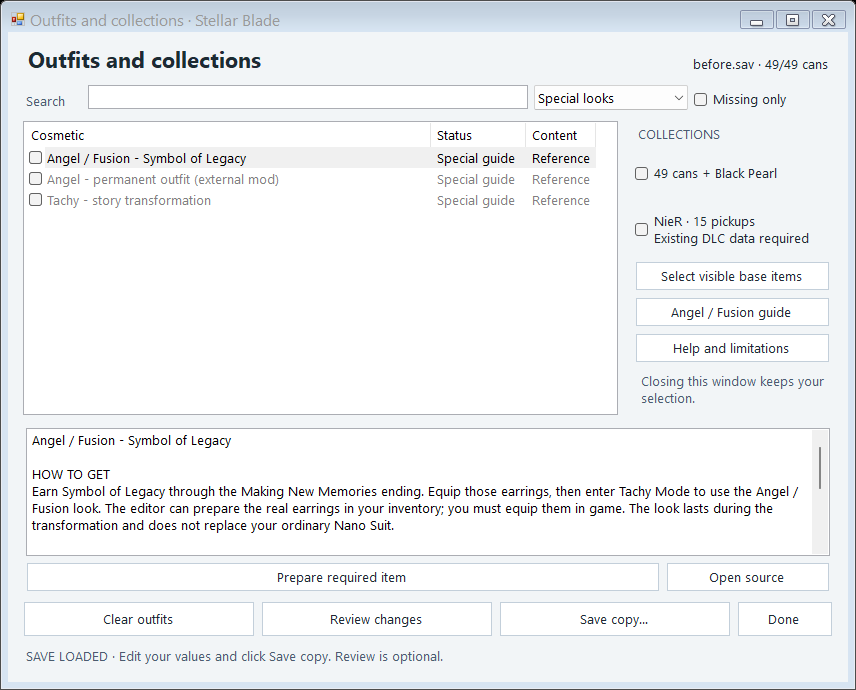

# Stellar Blade — All in One

A portable Windows save editor for NG+ gear and exospines, weapon/HP/Beta upgrades, gold, item quantities, unspent skill points, Emil’s Stellar Tears, outfits, and collection records.

[**Public GitHub releases**](https://github.com/birxx284/stellar-blade-all-in-one/releases/latest) · [Quick start](QUICKSTART.txt) · [Changelog](CHANGELOG.md) · [Cosmetic acquisition guide](docs/COSMETIC-GUIDE.md)



## What it does

- Edit gold from the main window.
- Open **Consumables and items** to edit existing consumables, ammo, materials, and supported currencies. Search and category filters keep the list focused.
- Open **Player upgrades and Emil’s shop** to select HP/Beta upgrade levels, optionally grant missing core credits, add/equip Burst Expansion Gear, edit unspent skill points and change the Stellar Tear balance.
- Open **Outfits and collections** for 304 verified cosmetics with acquisition descriptions, areas, locations, NG+/DLC requirements and source links. Browse the guide even without a save. The 49-can collection with Black Pearl and known NieR collection markers are also available.
- Use **Angel / Fusion guide** to prepare Symbol of Legacy, then equip the earrings and activate Tachy Mode in game. Three special references explain transformations and the separate permanent Angel mod. Uncatalogued cosmetic-like identifiers already in a loaded save are shown as read-only discoveries.
- Open **NG+ equipment and cores** for 24 exospines, 154 gear items, material grants and direct weapon upgrades. **Chill NG+ preset** prepares Mk2 equipment and upgrades in one shared session.
- Save directly after loading a valid save. Prepare and Review are optional: the current fields are collected and a fresh copy is validated automatically.
- Keep all pending edits in one session. Closing an auxiliary window keeps its selection; gold, item, and outfit changes are saved together.
- Read compatible **GVAS** and **EVAS v1** saves, validate EVAS CRC32 on opening, and recalculate it after editing.
- Create a permanent, verified backup of the complete original save every time a modified copy is saved. Existing files are never overwritten.

Optional in-game controls for money, health, energy and one consumable are included in a separate window. They require **manual memory calibration each session**. No automatic trainer profile is included.

## Use

1. Download `StellarBlade-AllInOne-0.7.0.zip` from the GitHub release and extract it.
2. Run `StellarBlade-AllInOne.exe`. No installation is needed; it can run from a USB drive.
3. Click **Open .sav**, **Paste path**, or **Find latest** on the PC containing your save.
4. Prepare your gold, item, player, or outfit changes. Close the auxiliary windows when finished; selections are preserved.
5. Click **Save copy** with the game closed. It collects the current values and validates automatically; **Review changes** is optional.

The modified file is a new copy. A verified original backup and recovery note are saved in `CopiasSeguridad` beside the destination. This folder name is retained for compatibility with earlier versions.

Typical Steam save location:

```text
%LOCALAPPDATA%\SB\Saved\SaveGames\<SteamID64>\StellarBladeSave00.sav
```

Select a main save, not `StellarBladeSetting.sav`. Opening a save does not require the game to be installed on the same PC.

## NG+ equipment and Chill preset

Open **NG+ equipment and cores** after loading a save. Its catalog contains **178 verified equipment entries**: 24 exospines (12 base + 12 Mk2) and 154 gear items (77 base + 77 Mk2). Every supported identifier was cross-checked against an actual inventory record in the research save. Unverified Common Burst Expansion Gear IDs are excluded. Gear labels describe their function; the save aliases are searchable too.

Select an item and click **Prepare selected item**, or use **All Mk2 equipment** / **All supported equipment**. Exospine levels can be granted from 1 to 3; existing higher levels are preserved. These upgrades do not charge module costs. Gear stays at its actual saved level 1; rarity and Mk2 are part of the item ID. Missing entries use a genuine same-save template of the matching category and get distinct identities. Unsupported templates and duplicate entries are rejected.

**Chill NG+ preset** prepares the following, without saving immediately:

- All 89 Mk2 equipment entries: 12 exospines at level 3 and 77 gear variants.
- HP/Beta core upgrade level 9 and weapon level 40, with missing upgrade credits granted when needed.
- At least 999 unspent SP and 500,000 gold; existing higher balances are preserved.
- Minimum stock of 100 for six supported core/module types and 1,000 for nine crafting/component materials, including stacks missing from inventory.
- At least 99 of each already-present supported consumable and 999 of each already-present supported ammo type.

Material stock is granted **before upgrade costs**. Example: weapon level 15 to 40 costs 25 cores; starting with zero and granting stock 100 leaves 75 after the upgrade. Exact manual quantity edits override minimum-stock grants before those costs. HP/Beta use 3 matching cores per level and weapon power uses 1 Weapon Core per level. No core count is silently added twice or spent twice.

Save the combined copy from the main window. **New equipment goes to inventory; equip your preferred loadout in game.** Already-equipped exospines retain the same inventory identity and receive matching upgraded levels. Other slots are preserved. The preset does not choose a loadout, learn skills automatically, open chests, unlock story abilities, complete quests or change difficulty. SP is available to spend on the skill tree in game. Existing NG+ state is required for Mk2 and for the Chill preset; a normal save stays a normal save. See the [NG+ guide](docs/NGPLUS-GUIDE.txt).

The official game limits and Mk2 additions are described by [Shift Up](https://blog.playstation.com/?p=391256). Actual in-game behavior of the editor's new operations still needs checking on the game PC.

## Appearance guide and Angel look

Select a catalog row to read **How to get**, area, location and requirements. Search matches those details as well as item names; categories and Missing only remain available. **Prepare selected item** queues an ordinary cosmetic. **Prepare required item** on a special reference queues only its actual underlying item, never a fabricated transformation ID. Save the combined copy from either editor window.

Coverage is **304 verified entries**: 126 EVE Nano Suits, 87 design patterns, 24 earrings, 23 hairstyles, 20 glasses, 9 drone appearances, 8 Adam outfits and 7 Lily outfits. These are entries rather than 304 separate EVE outfits. Future updates and arbitrary community mods are not claimed as supported. Unknown appearance-like identifiers already owned in a loaded save are informational only; their names and acquisition methods are unverified.

**Angel / Fusion:** Symbol of Legacy is the real accessory. The guide explains its Making New Memories ending reward and how equipping it changes Tachy Mode. Preparing it does not finish the ending or force-unlock the ability. [Official description of its effect](https://blog.playstation.com/2024/11/11/stellar-blades-nier-automata-dlc-photo-mode-launch-nov-20/).

**Permanent Angel:** the separate [Playable Angel Outfit by Kaineriqa](https://www.nexusmods.com/stellarblade/mods/296) replaces **Red Passion**. Its guide can prepare that base suit, then links to the author for installation. The mod files are not included, downloaded or installed by this editor. Check the author's current instructions and compatibility. No permanent Angel suit is invented in the save.

Acquisition descriptions are concise English summaries with location facts, not complete puzzle walkthroughs. They explain the original route; granting a cosmetic does not open its source container or complete its quest. Guide text and the printable [complete catalog](docs/COSMETIC-GUIDE.md) are in English.

## Scope and limitations

Supported item stacks must be present exactly once. Stellar Tears are also available at a zero balance when existing NieR save data is present; a missing exhausted stack can be created using a compatible currency stack from the same save. Separate equipped charges are preserved when increasing stock and clamped when reducing the total below them.

Outfit edits update inventory, ownership and known acquisition records. **Physical chests, quest completion, story state and Emil purchases are not changed.** NieR synchronization requires existing NieR save data; this tool does not activate DLC licenses. Other EVAS versions, invalid checksums, and unsupported structures are rejected with an opening report.

HP/Beta selectors remain enabled without spare cores. Choose a target upgrade level, then enable **Grant missing cores** if you want the editor to supply and spend the missing credits. With that option off, every added level requires 3 already-held cores. Normal/NG+ caps remain 6/9. **MAX means the supported limit is already reached**; going above it requires a separate game-data mod. This edits permanent upgrade levels, not current bar fill. World bodies are not marked as collected.

For **Burst maximum capacity**, choose a Burst Expansion Gear variant and either **Inventory only** or an existing unlocked gear slot. Missing gear is added using an actual same-save gear template; equipping uses its real inventory identity and replaces only the selected slot. The old gear remains in inventory. Inventory-only additions do not affect the bar until equipped in game. Duplicate equipment and locked slots are rejected. Bonus amounts are calculated by the game. This does not unlock Burst skills or change current energy, Tachy capacity, story progress or source chests.

Weapon power is editable in **NG+ equipment and cores**. Each added level costs 1 Weapon Core from the resulting stock, after material grants and explicit quantity edits. Optional missing-credit grants cover only a shortfall. The supported caps are 15 in a normal run and 40 in NG+; existing upgrades cannot be lowered. Alternatively grant Weapon Cores and spend them at a camp.

An end user reported successful operation of version 0.3.3 on their PC. Version 0.7.0 adds equipment grants, free exospine upgrades and weapon upgrades; these features have automated structural/workflow checks and have not been tested inside the game here. Automated tests check save structure, integrity, backups and the window workflow; they do not establish compatibility with every game build. Verify a modified copy in your own game before relying on it.

## Screenshots

### NG+ equipment and cores



### Player upgrades and Emil’s shop



### Consumables and items



### Outfits and collections



Screenshots use a constructed test save. No game save or account identifier is distributed.

## Build from source

Windows 64-bit with the .NET Framework 4.x C# compiler:

```powershell
.\build.ps1
```

Output: `dist\StellarBlade-AllInOne.exe`. There are no NuGet, WebView, or network dependencies.

The source includes integration checks for saves, EVAS envelopes, opening failures, the compact window workflow, and a separate memory fixture. Save tests require a compatible local test save; this repository intentionally does not include one. See [test instructions](docs/TESTING.md).

## License and credits

Apache-2.0; see [LICENSE.txt](LICENSE.txt) and [THIRD_PARTY_NOTICES.txt](THIRD_PARTY_NOTICES.txt).

The GVAS reader and wardrobe catalog are adapted from [perillaroc/sblade-explorer](https://github.com/perillaroc/sblade-explorer). EVAS format references are documented in the notices; their code is not incorporated. No source or binaries from Stellar Blade Mod Suite are included.

Unofficial project. Stellar Blade and related names belong to their respective owners. The app is offline and does not upload saves, change Steam IDs, or modify Steam Cloud.
